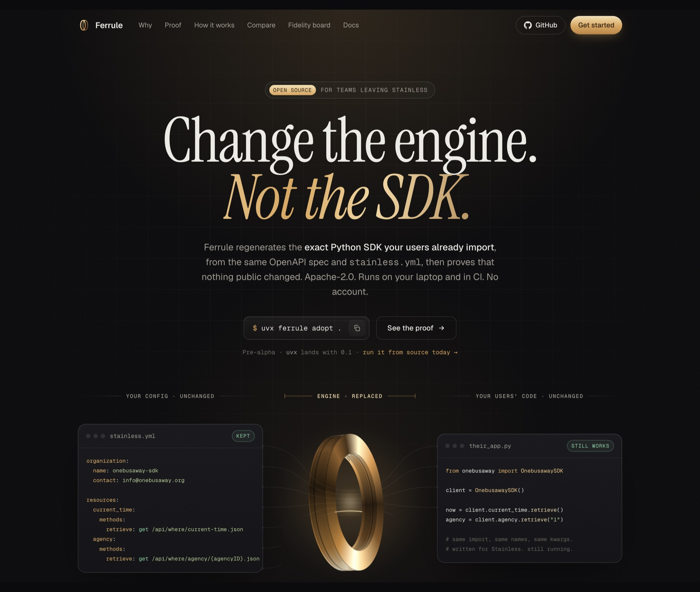
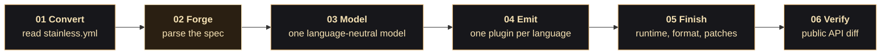

<p align="center">
  <a href="https://shrijayan.github.io/ferrule/">
    
  </a>
</p>

<h1 align="center">Ferrule</h1>

<p align="center">
  <strong>Change the engine. Not the SDK.</strong><br>
  The open-source way off Stainless: the same SDKs your users already import,<br>
  regenerated from the same spec and <code>stainless.yml</code>, with proof that nothing public changed.
</p>

<p align="center">
  <b>Python</b> · <b>TypeScript</b> · <b>Go</b> · <b>Java</b> · <b>Kotlin</b> · <b>Ruby</b> · <b>PHP</b> · <b>C#</b><br>
  Every major Stainless SDK language. Python is on <code>main</code>; the other seven are in review.<br>
  One Rust binary, 4.4 MB, with Forge built in. No Node, no WebAssembly.
</p>

<p align="center">
  <a href="https://shrijayan.github.io/ferrule/"></a>
  <a href="https://github.com/shrijayan/ferrule/actions/workflows/ci.yml"></a>
  <a href="./LICENSE"></a>
  
  <a href="#every-major-stainless-language"></a>
  <a href="#built-in-rust"></a>
  <a href="./CONTRIBUTING.md"></a>
</p>

<p align="center">
  <a href="https://shrijayan.github.io/ferrule/docs/quickstart/"><b>Quickstart</b></a> ·
  <a href="https://shrijayan.github.io/ferrule/docs/">Docs</a> ·
  <a href="https://shrijayan.github.io/ferrule/docs/commands/">Commands</a> ·
  <a href="https://shrijayan.github.io/ferrule/docs/fidelity/">Fidelity board</a> ·
  <a href="./docs/plan.html">Build plan</a>
</p>

<p align="center">
  <a href="https://shrijayan.github.io/ferrule/">
    
  </a>
</p>

---

## Your generator is going away. Your users aren't.

Thousands of developers import the SDKs you shipped, in Python, TypeScript, Go, Java and the
rest. Every class name, every argument, every `with_raw_response` is a promise. When the generator
behind them goes away, you have three options:

| | Option | What happens to your users |
| :-: | --- | --- |
| ✕ | Switch to another generator | It has its own house style. Names move, params change shape, and your users find out from a stack trace. |
| ✕ | Freeze the SDK and hand-maintain it | Fine until the API ships a new endpoint. Then the SDK drifts away from the spec it came from. |
| ✓ | **Ferrule: keep the SDKs, swap the engine** | **Nothing changes for them. That's the point.** |

## Not "compatible". Identical.

Here is the complete diff between a file from the last Stainless release of the
[OneBusAway Python SDK](https://github.com/OneBusAway/python-sdk) and Ferrule's output, generated
from the same spec and the same config:

```diff
  # src/onebusaway/resources/current_time.py
- # File generated from our OpenAPI spec by Stainless. See CONTRIBUTING.md for details.
+ # File generated from our OpenAPI spec by Ferrule. See CONTRIBUTING.md for details.
```

The only line that differs is the one that names the generator. Across the whole SDK:

| **0** | **1,110** | **80 / 80** | **byte-for-byte** |
| :-: | :-: | :-: | :-: |
| breaking changes to the public API | of the SDK's own tests pass on Ferrule's output | generated code files identical | the same output on every run |

## Every major Stainless language

Each language is proven the way Python was: regenerate a real public Stainless SDK from its own
spec and config, count the files that come out identical, and run the SDK's own tests. Numbers are
identical files out of the total.

| Language | Status | Proof against real Stainless SDKs | Where |
| --- | --- | --- | --- |
| **Python** | ✓ on `main` | onebusaway: 0 breaking, 1,110 of its own tests pass, 80/80 generated code files identical. With [#30](https://github.com/shrijayan/ferrule/pull/30), the Phase 4 gate adopts five real SDKs with 0 breaking and every test passing: onebusaway 1,110, lumaai 728, isaacus 472, honcho 1,241, knock-mgmt 468. | `main` |
| **TypeScript** | in review | isaacus-typescript 84/84, and its lint and 216 jest tests pass. onebusaway-typescript (node layout) 108/109. | [#27](https://github.com/shrijayan/ferrule/pull/27), [#29](https://github.com/shrijayan/ferrule/pull/29), [#34](https://github.com/shrijayan/ferrule/pull/34) |
| **Go** | in review | onebusaway-go: runtime 25/25, generated 65/69, builds and tests pass. v2 layout, imagekit-go: runtime 54/54, generated 17/45. | [#23](https://github.com/shrijayan/ferrule/pull/23), [#37](https://github.com/shrijayan/ferrule/pull/37) |
| **Java** | in review | onebusaway-java 328/343, imagekit-java 186/291. | [#32](https://github.com/shrijayan/ferrule/pull/32) |
| **Kotlin** | in review | onebusaway-kotlin 282/338. | [#32](https://github.com/shrijayan/ferrule/pull/32) |
| **Ruby** | in review | onebusaway-ruby 326/329, imagekit-ruby 348/432; both gems' own tests pass. | [#35](https://github.com/shrijayan/ferrule/pull/35) |
| **PHP** | in review | imagekit-php: runtime 48/48, generated 268 of 336 shared files; the package's 87 pest tests pass. | [#38](https://github.com/shrijayan/ferrule/pull/38) |
| **C#** | in review | imagekit-dotnet: runtime 38/38, generated 109/184 (38 more differ only in doc wrapping); builds with dotnet; the synthetic SDK's 89 tests pass. | [#39](https://github.com/shrijayan/ferrule/pull/39) |
| CLI, Terraform | not started | No public Stainless-generated CLI or provider pairs with a public config, so there is no oracle to prove against yet. | |

The new languages are generated from one language-neutral model
([`crates/sdk-model`](https://github.com/shrijayan/ferrule/pull/17),
[ADR 0017](./docs/adr/0017-multi-language-targets.md)), with one plugin crate per language and
runtimes copied from Apache-2.0 Stainless SDKs. Python keeps its own adapter for now and moves
onto the same model later, as the ADR plans.

## Built in Rust

The converter, the model and every language plugin are Rust
([ADR 0014](./docs/adr/0014-rust-for-converter-and-plugin.md)). The TypeScript and WebAssembly
toolchain is gone.

| **1 binary** | **~15 ms** | **~25 ms** | **~40 ms** |
| :-: | :-: | :-: | :-: |
| `ferrule-gen`, 4.4 MB, Forge built in natively | to convert `stainless.yml` | to generate the SDK | for the whole onebusaway SDK |

Measured on onebusaway (30 operations, 196 files) on an Apple M4 Pro, release build, `main` at
`8924b55`. Formatting with ruff runs separately. Generation needs no Node and no WebAssembly, and
the output is byte-identical on every run.

## How it works

Ferrule doesn't build another generator. [Forge](https://github.com/cloudflare/forge),
Cloudflare's Apache-2.0 engine, parses the spec. Ferrule adds everything Forge doesn't do: reading
your config, a language-neutral model, one plugin per language that writes Stainless-shaped code,
and proving the result.



Stages 01 to 04 run in one native binary, `ferrule-gen`. Each language has its own plugin: Python's
is on `main`, and the TypeScript, Go, Java and Kotlin, Ruby, PHP and C# plugins are in review,
where `ferrule-gen --target <lang>` picks one.

**In:** `openapi.yml`, `stainless.yml`, your hand edits, your last release.
**Out:** the SDKs your users already import, plus `ferrule.lock` and a verify report.

## Quickstart

> [!IMPORTANT]
> Ferrule is **pre-alpha** and not on PyPI yet. The 0.1 release is planned to make this
> `uvx ferrule adopt .`; until then, build it from source.

```bash
git clone https://github.com/shrijayan/ferrule && cd ferrule
mise install && mise run install            # toolchain and dependencies
cargo build --release -p ferrule-gen        # converter, Forge and plugin in one binary

uv run ferrule adopt ~/code/acme-python --config ~/code/acme-config/stainless.yml
```

```text
✓ read .stats.yml → spec URL + hash
✓ rescued spec to ./openapi.json (hash ok)
✓ converted stainless.yml → overlays
✓ copied runtime from your repo (you own it)
✓ found 3 hand edits → .ferrule/patches/
✓ generated via ferrule-gen (forge + ferrule-python)
✓ committed 'Switch SDK generation to Ferrule' on local branch ferrule/adopt (not pushed)
ferrule verify --against 1a2b3c4
public API: 0 breaking · 6 additive
```

The full walkthrough, from prerequisites to what to do on an error, is in the
[quickstart](https://shrijayan.github.io/ferrule/docs/quickstart/).

## What happens next

1. **Adopt locally.** `adopt` works in a temporary git worktree, so your checkout is never touched.
2. **Review one commit.** The branch `ferrule/adopt` holds the rescued spec, your patches,
   `ferrule.lock` and a workflow. Generated files differ by one header line.
3. **Push and let CI test it.** Your existing test suite runs against the regenerated code.
4. **Merge and release.** Nothing your users import changed, so it ships as a patch release.
5. **Stay current.** The workflow regenerates on every spec change and opens a PR labelled
   `major`, `minor` or `patch`. A breaking change needs a human's label to pass.

## What you get

- **Proof that nothing broke.** `ferrule verify` diffs the public API against your last release,
  reading the code with griffe and never importing it.
- **Your spec, rescued.** Every Stainless repo's `.stats.yml` points at a spec in a bucket you
  don't control. `ferrule rescue` saves it and checks the hash. Worth running today.
- **Output you own.** No licence obligations on generated code, and the SDK never depends on
  Ferrule or Forge. In adopt mode the runtime is copied from your own repository.
- **Hand edits that survive.** Custom changes become patches, re-applied three-way on every
  regeneration. `lib/` and `keep_files` are never touched.
- **A GitHub Action that keeps it current.** It regenerates, verifies and opens a labelled PR.
- **A public [fidelity board](https://shrijayan.github.io/ferrule/docs/fidelity/).** Real public
  Stainless SDKs, regenerated every night, scores published, including the ones that aren't green
  yet.
- **Docs for coding agents, in the wheel.** `SKILL.md`, `AGENTS.md` and `llms.txt` ship inside the
  package under `_agent/`, locked to the installed version, with tested recipes in
  `examples/agent/`.
- **Coming in phase 5:** a fake server in every SDK, so code runs without an API key.

## Compared with the alternatives

| | **Ferrule** | Open-core generator (free tier) | Hosted platform | Freeze and hand-maintain |
| --- | --- | --- | --- | --- |
| Reads your `stainless.yml` as-is | ✓ | ✕ | Partly | n/a |
| Same SDK your users import, in each language | ✓ identical, proven per language | ✕ its own style | Close | ✓ until the spec changes |
| Proof nothing broke | ✓ `ferrule verify` | ✕ | ✕ | ✕ |
| Licence of generated code | ✓ yours | ✕ copyleft on the free path | Vendor terms | ✓ yours |
| Account, token or login | ✓ none | ✕ required | ✕ required | ✓ none |
| Runs offline, in your CI | ✓ | With a key | ✕ hosted | ✓ |
| Keeps up with the spec | ✓ labelled PRs | ✓ | ✓ | ✕ |

<sub>Summary of public terms as of October 2026. Check each vendor's current terms before deciding.</sub>

## Open by design

Ferrule will never ask for ~~hosted generation~~, ~~licence tokens~~, ~~logins~~,
~~telemetry~~, ~~a CLA~~ or ~~relicensing~~.

Everything that runs on your machine stays open. Contributors sign off with a
[DCO](./CONTRIBUTING.md) and keep their copyright, so nobody can take the project closed. Not even
us.

## The repository

| Part | What it does |
| --- | --- |
| [`crates/converter/`](./crates/converter) | Rust: `stainless.yml` → annotated OpenAPI spec (overlays and `x-ferrule-*`) |
| [`crates/python-plugin/`](./crates/python-plugin) | Rust: the Forge plugin that emits the Python SDK, run natively in Forge |
| [`crates/ferrule-gen/`](./crates/ferrule-gen) | Rust: the `ferrule-gen` binary that runs the converter, then Forge with the plugin |
| `crates/sdk-model/` | In review ([#17](https://github.com/shrijayan/ferrule/pull/17)). Rust: the language-neutral model and the only adapter from Forge |
| `crates/ts-plugin/`, `go-plugin/`, `jvm-plugin/`, `ruby-plugin/`, `php-plugin/`, `csharp-plugin/` | In review ([#27](https://github.com/shrijayan/ferrule/pull/27), [#23](https://github.com/shrijayan/ferrule/pull/23), [#32](https://github.com/shrijayan/ferrule/pull/32), [#35](https://github.com/shrijayan/ferrule/pull/35), [#38](https://github.com/shrijayan/ferrule/pull/38), [#39](https://github.com/shrijayan/ferrule/pull/39)). Rust: one plugin per language; `jvm-plugin` writes Java and Kotlin |
| [`runtime/`](./runtime) | The Python runtime copied into every generated SDK |
| [`migrate/`](./migrate) | The `ferrule` CLI: `generate`, `adopt`, `rescue`, `verify`, `merge` |
| [`action/`](./action) | The GitHub Action that keeps adopted SDKs regenerating |
| [`oracles/`](./oracles), [`corpus/`](./corpus) | Real SDKs and specs every change is tested against |
| [`site/`](./site) | The website and docs, deployed to GitHub Pages |

Decisions live in [`docs/adr/`](./docs/adr/) and the full plan in [`docs/plan.html`](./docs/plan.html).

## Contributing

```bash
mise install        # Rust, Python, uv, Node and pnpm (site only), lefthook, gitleaks
mise run install    # Python and site dependencies
mise run check      # everything CI runs
```

Bugs are fixed test-first, commits use Conventional Commits with a DCO sign-off (`git commit -s`),
and there is never a CLA. Start with [CONTRIBUTING.md](./CONTRIBUTING.md); see also
[GOVERNANCE.md](./GOVERNANCE.md) and [SECURITY.md](./SECURITY.md).

## Licence

Apache-2.0. See [LICENSE](./LICENSE) and [NOTICE](./NOTICE).

<sub>Ferrule is independent and not affiliated with Stainless or Cloudflare. A ferrule is the metal
collar that joins two parts so firmly you forget there's a joint. That's the job.</sub>
